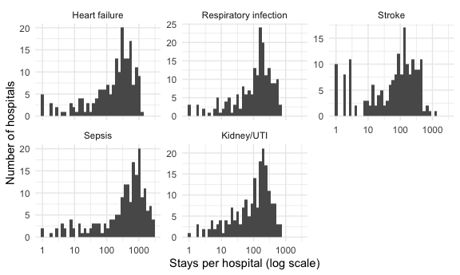
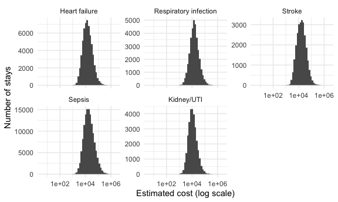

Analysis Rules
================

``` r
library(tidyverse)

knitr::opts_chunk$set(
  fig.width = 6,
  fig.asp = .6,
  out.width = "90%"
)

theme_set(theme_minimal() + theme(legend.position = "bottom"))

options(
  ggplot2.continuous.colour = "viridis",
  ggplot2.continuous.fill = "viridis"
)

scale_colour_discrete = scale_colour_viridis_d
scale_fill_discrete = scale_fill_viridis_d
```

Before analysis, we need three rules everyone uses: how to handle
unusually low costs, a minimum number of stays per hospital, and what to
do with stays where charges are lower than costs.

## Load the clean data

``` r
sparcs_clean =
  read_csv(
    "./data/sparcs_clean.csv",
    col_types = cols(
      severity  = col_factor(levels = c("Minor", "Moderate", "Major", "Extreme")),
      payer     = col_factor(levels = c("Medicare", "Medicaid", "Private", "Other")),
      ownership = col_factor(levels = c("Nonprofit", "Public")),
      condition = col_factor(levels = c("Heart failure", "Respiratory infection", "Stroke", "Sepsis", "Kidney/UTI")),
      age_group = col_factor(levels = c("0 to 17", "18 to 29", "30 to 49", "50 to 69", "70 or Older"))
    )
  )
```

## Minimum stays per hospital

``` r
# stays per hospital within each condition
hosp_volume =
  sparcs_clean |>
  count(condition, hosp_id)

# what does hospital volume look like?
hosp_volume |>
  ggplot(aes(x = n)) +
  geom_histogram(bins = 40) +
  facet_wrap(~ condition, scales = "free_y") +
  scale_x_log10() +
  labs(x = "Stays per hospital (log scale)", y = "Number of hospitals")
```



``` r
# how many hospitals and stays we keep under different cutoffs
tibble(cutoff = c(10, 20, 30, 50)) |>
  mutate(
    kept = map(cutoff, \(k)
      hosp_volume |>
        filter(n >= k) |>
        group_by(condition) |>
        summarize(n_hosp = n(), n_stays = sum(n))
    )
  ) |>
  unnest(kept) |>
  pivot_wider(
    names_from = cutoff,
    values_from = c(n_hosp, n_stays)
  )
```

    ## # A tibble: 5 × 9
    ##   condition        n_hosp_10 n_hosp_20 n_hosp_30 n_hosp_50 n_stays_10 n_stays_20
    ##   <fct>                <int>     <int>     <int>     <int>      <int>      <int>
    ## 1 Heart failure          173       163       159       155      59582      59433
    ## 2 Respiratory inf…       174       162       156       145      34939      34761
    ## 3 Stroke                 147       135       126       115      26423      26264
    ## 4 Sepsis                 172       167       164       156     130975     130906
    ## 5 Kidney/UTI             170       159       148       134      30148      29999
    ## # ℹ 2 more variables: n_stays_30 <int>, n_stays_50 <int>

## Unusually low costs

``` r
# costs by condition (log scale since costs are very skewed)
sparcs_clean |>
  ggplot(aes(x = costs)) +
  geom_histogram(bins = 50) +
  facet_wrap(~ condition, scales = "free_y") +
  scale_x_log10() +
  labs(x = "Estimated cost (log scale)", y = "Number of stays")
```



``` r
# how many stays fall below different cost floors?
sparcs_clean |>
  summarize(
    under_100  = sum(costs < 100),
    under_500  = sum(costs < 500),
    under_1000 = sum(costs < 1000)
  )
```

    ## # A tibble: 1 × 3
    ##   under_100 under_500 under_1000
    ##       <int>     <int>      <int>
    ## 1        10        20         52

``` r
# stays where charges are lower than costs (odd, worth a look)
sparcs_clean |>
  summarize(charges_below_costs = sum(charges < costs))
```

    ## # A tibble: 1 × 1
    ##   charges_below_costs
    ##                 <int>
    ## 1                3546

``` r
# are charges < costs concentrated in a few hospitals?
sparcs_clean |>
  filter(charges < costs) |>
  count(facility_name) |>
  arrange(desc(n)) |>
  head(10)
```

    ## # A tibble: 10 × 2
    ##    facility_name                                                               n
    ##    <chr>                                                                   <int>
    ##  1 BronxCare Hospital Center                                                2769
    ##  2 St. Joseph's Hospital Health Center                                       111
    ##  3 UPMC Chautauqua at WCA                                                     94
    ##  4 Mount St. Mary's Hospital and Health Center                                86
    ##  5 The University of Vermont Health Network - Elizabethtown Community Hos…    56
    ##  6 Huntington Hospital                                                        49
    ##  7 Carthage Area Hospital Inc                                                 37
    ##  8 O'Connor Hospital                                                          37
    ##  9 Wyoming County Community Hospital                                          33
    ## 10 Cobleskill Regional Hospital                                               31

``` r
# share of BronxCare stays where charges < costs
sparcs_clean |>
  filter(facility_name == "BronxCare Hospital Center") |>
  summarize(
    n_stays = n(),
    share_below = mean(charges < costs)
  )
```

    ## # A tibble: 1 × 2
    ##   n_stays share_below
    ##     <int>       <dbl>
    ## 1    3299       0.839

## Rules

1.  **Very low costs:** We drop 20 stays with estimated costs under
    \$500. These are too low to be real hospital stays.
2.  **Small hospitals:** For rankings, regression, and comparing
    conditions, we only keep hospitals with at least 30 stays for that
    condition. This still keeps 126 to 164 hospitals per condition and
    over 99% of stays. The funnel plot uses all hospitals, since it is
    meant to show how much small hospitals bounce around by chance.
3.  **Charges lower than costs:** We keep the 3,546 stays (1.3%) where
    charges are lower than costs. Most of them are from BronxCare
    Hospital Center, where 84% of stays look like this. This looks like
    how BronxCare sets its prices, not a data error.
