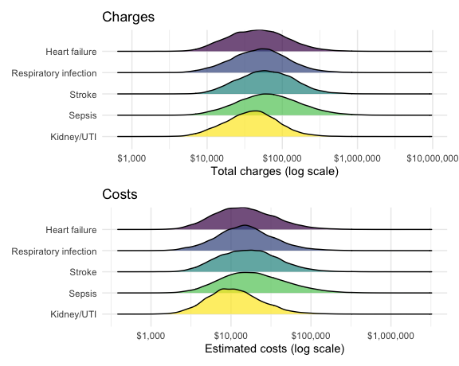
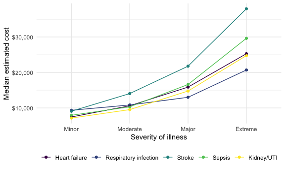
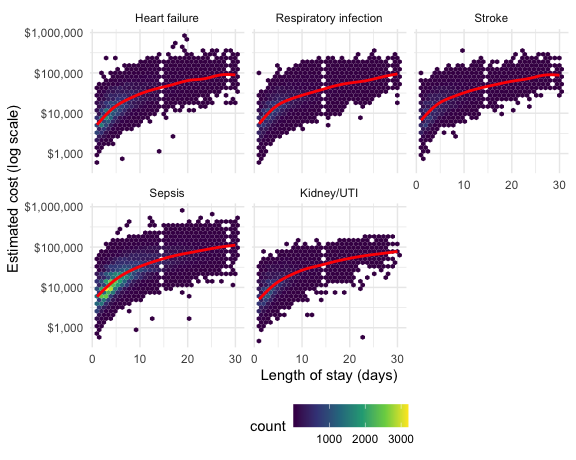
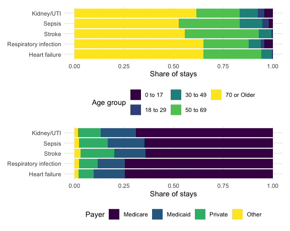
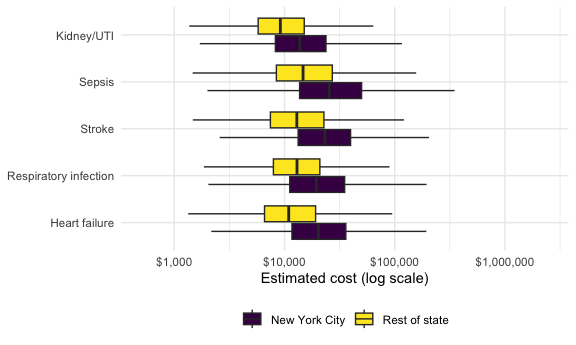
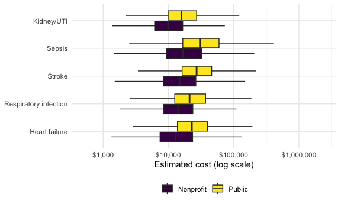

Exploratory Data Analysis
================

``` r
library(tidyverse)
library(ggridges)
library(patchwork)

knitr::opts_chunk$set(
  fig.width = 6,
  fig.asp = .6,
  out.width = "90%"
)

theme_set(theme_minimal() + theme(legend.position = "bottom"))

options(
  ggplot2.continuous.colour = "viridis",
  ggplot2.continuous.fill = "viridis"
)

scale_colour_discrete = scale_colour_viridis_d
scale_fill_discrete = scale_fill_viridis_d
```

## Load data

``` r
sparcs_clean =
  read_csv(
    "./data/sparcs_clean.csv",
    col_types = cols(
      condition = col_factor(levels = c("Heart failure", "Respiratory infection", "Stroke", "Sepsis", "Kidney/UTI")),
      severity  = col_factor(levels = c("Minor", "Moderate", "Major", "Extreme")),
      age_group = col_factor(levels = c("0 to 17", "18 to 29", "30 to 49", "50 to 69", "70 or Older")),
      payer     = col_factor(levels = c("Medicare", "Medicaid", "Private", "Other")),
      ownership = col_factor(levels = c("Nonprofit", "Public"))
    )
  )

# apply our rule: drop stays with costs under $500 (too low to be real)
sparcs_eda =
  sparcs_clean |>
  filter(costs >= 500)

# how many we dropped
nrow(sparcs_clean) - nrow(sparcs_eda)
```

    ## [1] 20

## Overview

``` r
# basic numbers for each condition
sparcs_eda |>
  group_by(condition) |>
  summarize(
    stays          = n(),
    hospitals      = n_distinct(hosp_id),
    median_los     = median(los),
    median_charges = median(charges),
    median_costs   = median(costs)
  ) |>
  knitr::kable(digits = 0, format.args = list(big.mark = ","))
```

| condition | stays | hospitals | median_los | median_charges | median_costs |
|:---|---:|---:|---:|---:|---:|
| Heart failure | 59,633 | 189 | 5 | 46,607 | 14,074 |
| Respiratory infection | 35,005 | 190 | 5 | 50,495 | 14,760 |
| Stroke | 26,520 | 182 | 4 | 60,426 | 16,288 |
| Sepsis | 131,038 | 187 | 6 | 64,343 | 18,104 |
| Kidney/UTI | 30,228 | 188 | 4 | 39,427 | 10,684 |

## How spread out are charges and costs?

``` r
# charges and costs are very right-skewed, so we use a log scale
charges_plot =
  sparcs_eda |>
  ggplot(aes(x = charges, y = fct_rev(condition), fill = condition)) +
  geom_density_ridges(alpha = .7, scale = 1.2) +
  scale_x_log10(labels = scales::dollar) +
  labs(x = "Total charges (log scale)", y = NULL, title = "Charges") +
  theme(legend.position = "none")

costs_plot =
  sparcs_eda |>
  ggplot(aes(x = costs, y = fct_rev(condition), fill = condition)) +
  geom_density_ridges(alpha = .7, scale = 1.2) +
  scale_x_log10(labels = scales::dollar) +
  labs(x = "Estimated costs (log scale)", y = NULL, title = "Costs") +
  theme(legend.position = "none")

charges_plot / costs_plot
```

    ## Picking joint bandwidth of 0.0397

    ## Picking joint bandwidth of 0.0383



## Does severity matter?

``` r
# median cost goes up with severity, how fast for each condition?
sparcs_eda |>
  group_by(condition, severity) |>
  summarize(median_costs = median(costs), n = n(), .groups = "drop") |>
  ggplot(aes(x = severity, y = median_costs, color = condition, group = condition)) +
  geom_point() +
  geom_line() +
  scale_y_continuous(labels = scales::dollar) +
  labs(x = "Severity of illness", y = "Median estimated cost", color = NULL)
```



``` r
# how many stays at each severity level?
sparcs_eda |>
  count(condition, severity) |>
  pivot_wider(names_from = severity, values_from = n) |>
  knitr::kable(format.args = list(big.mark = ","))
```

| condition             | Minor | Moderate |  Major | Extreme |
|:----------------------|------:|---------:|-------:|--------:|
| Heart failure         | 3,959 |   20,000 | 25,587 |  10,087 |
| Respiratory infection |   505 |    2,492 | 21,000 |  11,008 |
| Stroke                | 3,162 |   13,718 |  7,106 |   2,534 |
| Sepsis                | 4,628 |   25,913 | 45,320 |  55,177 |
| Kidney/UTI            | 4,980 |   14,564 |  9,570 |   1,114 |

## Length of stay and cost

``` r
# longer stays cost more, but is it a straight line?
# (only showing stays up to 30 days so the plot is readable)
sparcs_eda |>
  filter(los <= 30) |>
  ggplot(aes(x = los, y = costs)) +
  geom_hex(bins = 30) +
  geom_smooth(se = FALSE, color = "red") +
  scale_y_log10(labels = scales::dollar) +
  facet_wrap(~ condition) +
  labs(x = "Length of stay (days)", y = "Estimated cost (log scale)")
```

    ## `geom_smooth()` using method = 'gam' and formula = 'y ~ s(x, bs = "cs")'



## Who are the patients?

``` r
# age groups by condition
age_plot =
  sparcs_eda |>
  ggplot(aes(x = condition, fill = age_group)) +
  geom_bar(position = "fill") +
  coord_flip() +
  labs(x = NULL, y = "Share of stays", fill = "Age group") +
  guides(fill = guide_legend(nrow = 2))

# payers by condition
payer_plot =
  sparcs_eda |>
  ggplot(aes(x = condition, fill = payer)) +
  geom_bar(position = "fill") +
  coord_flip() +
  labs(x = NULL, y = "Share of stays", fill = "Payer")

age_plot / payer_plot
```



## Where are the hospitals?

``` r
# NYC vs other regions
sparcs_eda |>
  mutate(
    region = if_else(hospital_service_area == "New York City", "New York City", "Rest of state")
  ) |>
  ggplot(aes(x = condition, y = costs, fill = region)) +
  geom_boxplot(outlier.shape = NA) +
  scale_y_log10(labels = scales::dollar) +
  coord_flip() +
  labs(x = NULL, y = "Estimated cost (log scale)", fill = NULL)
```



``` r
# nonprofit vs public hospitals (6 hospitals with no ownership info are dropped here)
sparcs_eda |>
  drop_na(ownership) |>
  ggplot(aes(x = condition, y = costs, fill = ownership)) +
  geom_boxplot(outlier.shape = NA) +
  scale_y_log10(labels = scales::dollar) +
  coord_flip() +
  labs(x = NULL, y = "Estimated cost (log scale)", fill = NULL)
```



Public hospitals look more expensive, but NYC hospitals are more
expensive in general. Here we compare within each region: public
hospitals still have higher median costs in both NYC and the rest of the
state.

``` r
# is the public vs nonprofit gap still there within each region?
sparcs_eda |>
  drop_na(ownership) |>
  mutate(region = if_else(hospital_service_area == "New York City", "NYC", "Rest of state")) |>
  group_by(region, ownership) |>
  summarize(
    hospitals    = n_distinct(hosp_id),
    median_costs = median(costs),
    .groups = "drop"
  ) |>
  knitr::kable(format.args = list(big.mark = ","))
```

| region        | ownership | hospitals | median_costs |
|:--------------|:----------|----------:|-------------:|
| NYC           | Nonprofit |        40 |    20,133.03 |
| NYC           | Public    |        13 |    29,730.67 |
| Rest of state | Nonprofit |       117 |    12,072.27 |
| Rest of state | Public    |        16 |    20,108.17 |

We keep children in the analysis (see analysis rules). Here is how many
there are.

``` r
# how many stays are children in each condition?
sparcs_eda |>
  filter(age_group == "0 to 17") |>
  count(condition)
```

    ## # A tibble: 5 × 2
    ##   condition                 n
    ##   <fct>                 <int>
    ## 1 Heart failure            43
    ## 2 Respiratory infection  1473
    ## 3 Stroke                   33
    ## 4 Sepsis                 2409
    ## 5 Kidney/UTI             1304
