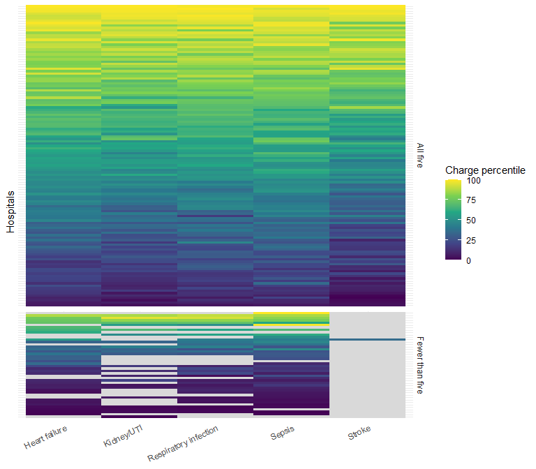

Hospital rankings across conditions
================
Jiaxuan Su

## Do hospitals rank similarly across conditions?

For each pair of conditions, we included hospitals with at least 30
eligible stays for both conditions. We compared hospital median charges,
median estimated costs, and markup. Markup is the median charge divided
by the median cost.

Charge correlations ranged from 0.942 to 0.974. Hospitals that charged
more for one condition also tended to charge more for the others. We
resampled hospitals 1,000 times to estimate each 95% confidence
interval. The shuffled range shows the middle 95% of correlations after
randomly matching hospitals 1,000 times.

## Pairwise results

### Charges

| Conditions | Hospitals | Correlation | 95% CI | Shuffled range |
|:---|---:|---:|:---|:---|
| Heart failure / Respiratory infection | 151 | 0.966 | 0.948 to 0.975 | -0.161 to 0.159 |
| Heart failure / Stroke | 126 | 0.958 | 0.936 to 0.970 | -0.171 to 0.175 |
| Heart failure / Sepsis | 155 | 0.967 | 0.953 to 0.975 | -0.143 to 0.160 |
| Heart failure / Kidney/UTI | 143 | 0.966 | 0.947 to 0.976 | -0.166 to 0.156 |
| Respiratory infection / Stroke | 126 | 0.949 | 0.922 to 0.964 | -0.177 to 0.186 |
| Respiratory infection / Sepsis | 155 | 0.947 | 0.920 to 0.965 | -0.152 to 0.150 |
| Respiratory infection / Kidney/UTI | 147 | 0.974 | 0.959 to 0.980 | -0.160 to 0.160 |
| Stroke / Sepsis | 126 | 0.954 | 0.931 to 0.968 | -0.168 to 0.182 |
| Stroke / Kidney/UTI | 125 | 0.942 | 0.913 to 0.958 | -0.168 to 0.161 |
| Sepsis / Kidney/UTI | 146 | 0.950 | 0.923 to 0.964 | -0.161 to 0.178 |

### Costs

| Conditions | Hospitals | Correlation | 95% CI | Shuffled range |
|:---|---:|---:|:---|:---|
| Heart failure / Respiratory infection | 151 | 0.895 | 0.846 to 0.932 | -0.156 to 0.160 |
| Heart failure / Stroke | 126 | 0.913 | 0.867 to 0.939 | -0.180 to 0.184 |
| Heart failure / Sepsis | 155 | 0.928 | 0.897 to 0.950 | -0.157 to 0.160 |
| Heart failure / Kidney/UTI | 143 | 0.943 | 0.914 to 0.960 | -0.155 to 0.175 |
| Respiratory infection / Stroke | 126 | 0.824 | 0.738 to 0.885 | -0.166 to 0.175 |
| Respiratory infection / Sepsis | 155 | 0.862 | 0.788 to 0.913 | -0.173 to 0.161 |
| Respiratory infection / Kidney/UTI | 147 | 0.930 | 0.891 to 0.957 | -0.161 to 0.155 |
| Stroke / Sepsis | 126 | 0.903 | 0.844 to 0.936 | -0.170 to 0.177 |
| Stroke / Kidney/UTI | 125 | 0.867 | 0.800 to 0.911 | -0.169 to 0.172 |
| Sepsis / Kidney/UTI | 146 | 0.914 | 0.862 to 0.946 | -0.169 to 0.153 |

### Markup

| Conditions | Hospitals | Correlation | 95% CI | Shuffled range |
|:---|---:|---:|:---|:---|
| Heart failure / Respiratory infection | 151 | 0.954 | 0.931 to 0.970 | -0.158 to 0.168 |
| Heart failure / Stroke | 126 | 0.944 | 0.904 to 0.965 | -0.166 to 0.174 |
| Heart failure / Sepsis | 155 | 0.984 | 0.973 to 0.989 | -0.162 to 0.152 |
| Heart failure / Kidney/UTI | 143 | 0.980 | 0.966 to 0.987 | -0.154 to 0.162 |
| Respiratory infection / Stroke | 126 | 0.925 | 0.882 to 0.952 | -0.169 to 0.175 |
| Respiratory infection / Sepsis | 155 | 0.973 | 0.959 to 0.981 | -0.155 to 0.172 |
| Respiratory infection / Kidney/UTI | 147 | 0.966 | 0.943 to 0.978 | -0.152 to 0.163 |
| Stroke / Sepsis | 126 | 0.951 | 0.917 to 0.970 | -0.178 to 0.165 |
| Stroke / Kidney/UTI | 125 | 0.938 | 0.890 to 0.963 | -0.174 to 0.181 |
| Sepsis / Kidney/UTI | 146 | 0.982 | 0.970 to 0.988 | -0.159 to 0.160 |

## Hospital rankings

Each row is a hospital. Yellow indicates higher charges within a
condition. Gray means the hospital had fewer than 30 eligible stays for
that condition, including zero.

<!-- -->

The table ranks the 125 hospitals with enough cases for all five
conditions. Each condition contributes equally to the average charge
percentile.

| Highest charges | Mean percentile (high) | Lowest charges | Mean percentile (low) |
|:---|---:|:---|---:|
| Westchester Medical Center | 99.6 | F.F. Thompson Hospital | 4.5 |
| NYU Langone Hospital-Long Island | 98.1 | Olean General Hospital | 6.9 |
| Mid-Hudson Valley Division of Westchester Medical Center | 97.7 | UPMC Chautauqua at WCA | 7.3 |
| NewYork-Presbyterian Brooklyn Methodist Hospital | 96.4 | Mount St. Mary’s Hospital and Health Center | 8.1 |
| Long Island Community Hospital at NYU Langone Health | 95.9 | Geneva General Hospital | 8.8 |
| NYU Langone Hospital-Brooklyn | 94.2 | United Memorial Medical Center North Street Campus | 10.0 |
| North Shore University Hospital | 92.9 | Highland Hospital | 13.3 |
| New York-Presbyterian Hospital - New York Weill Cornell Center | 92.5 | The Unity Hospital of Rochester | 13.5 |
| Montefiore Med Center - Jack D Weiler Hosp of A Einstein College Div | 91.5 | Flushing Hospital Medical Center | 14.2 |
| NYU Langone Hospitals | 90.8 | Kenmore Mercy Hospital | 15.5 |
